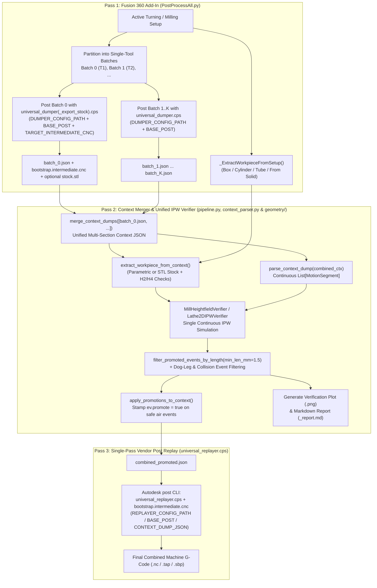

# Context-Dump, Unified Verification & Single-Pass Replay Architecture

> This document defines the authoritative architecture and tool interfaces for the **Fusion 360 Batch Post & Unified IPW Verification Pipeline** (supporting both **3D Milling** and **2D Turning**), superseding earlier per-batch wrapper and G-code text stitching prototypes.

---

## 1. Architectural Motivation & Core Principles

### 1.1 Why Context-Dump + Single-Pass Replay?
Fusion 360 Personal Edition enforces two fundamental restrictions on turning and multi-tool setups:
1. **Multi-Tool Post Restriction**: Fusion Personal Edition blocks `NCProgram.postProcess()` when operations in a single `NCProgram` use multiple distinct tool numbers (`T1`, `T2`, etc.).
2. **High-Feed Linear Substitution**: Fusion Personal Edition replaces rapid traverse moves (`G0` / `MOVEMENT_RAPID`) with high-feed linear moves (`G1` / `MOVEMENT_HIGH_FEED`) inside the CAM kernel before invoking any `.cps` post processor.

Earlier iterations attempted to work around the multi-tool restriction by posting each single-tool batch into separate G-code files and stitching those G-code files together with regular expressions (`_StitchGcodeFiles`). However, text-level G-code stitching is inherently fragile across diverse CNC dialects (Centroid, Tormach PathPilot, ShopBot OpenSBP, Acu-Rite MillPwr G2, Fanuc, Haas) because each vendor post has its own:
- Header tool table and global Z-range summary (`getToolTable()`, `getGlobalZRange()`),
- Dialect-specific tool change sequences, safety retracts (`G28`, `G53`, `M9`, `M5`), and work-offset resets,
- Cross-section lookahead (`getPreviousSection()`, `getNextSection()`, `getNextTool()`),
- Modal state machines (`gMotionModal`, `gPlaneModal`, `gAbsIncModal`, `gFeedModeModal`, `feedOutput`),
- Sequence numbering (`N10`, `N20`, ...).

By separating **Pass 1: Per-Batch Context Extraction (`universal_dumper.cps`)** from **Pass 2: Unified Verification & Single-Pass Vendor Replay (`universal_replayer.cps`)**, we execute the **unmodified vendor `.cps` script once** across the entire merged multi-tool setup inside the official Autodesk `post` binary.

---

### 1.2 Seven Core Architectural Invariants
1. **Single Pathway (Zero G-Code Parsing)**: Never parse machine G-code (`parse_cnc_file` is permanently removed). All geometric verification operates strictly on exact floating-point coordinates captured from the Fusion Post Kernel via [`universal_dumper.cps`](file:///Users/vadimf/Documents/Fusion360-Batch-Post-master/universal_dumper.cps).
2. **Per-Batch Context Extraction**: Operations in a setup are partitioned into single-tool batches (`[(tool_num, [op1, ...]), ...]`). Each single-tool batch is posted individually through [`universal_dumper.cps`](file:///Users/vadimf/Documents/Fusion360-Batch-Post-master/universal_dumper.cps) (or staged [`universal_dumper_export_stock.cps`](file:///Users/vadimf/Documents/Fusion360-Batch-Post-master/PostProcessAll.py#L2713-L2720) for Batch 0 of `"From Preceding Setup"` setups so `post --interrogate` Safe Mode enables native STL stock export).
3. **Dialect-Independent Multi-Operation Merging**: [`merge_context_dumps()`](file:///Users/vadimf/Documents/Fusion360-Batch-Post-master/context_parser.py#L31-L132) in [`context_parser.py`](file:///Users/vadimf/Documents/Fusion360-Batch-Post-master/context_parser.py) merges the per-batch JSON context dumps into a single unified multi-section context document, re-indexing `id` (`0..N-1`), `batchIdx`, and `batchSectionIdx`, and propagating `stockPath`, `stockMode`, `stockUnit`, `workpieceHint`, and `rapidMode`.
4. **Unified Continuous IPW Verification**: [`parse_context_dump()`](file:///Users/vadimf/Documents/Fusion360-Batch-Post-master/context_parser.py#L135-L475) extracts a single continuous `List[MotionSegment]` across all tools and operations. [`MillHeightfieldVerifier.verify_toolpath()`](file:///Users/vadimf/Documents/Fusion360-Batch-Post-master/geometry/heightfield_engine.py#L243-L738) (for 3D Milling) or [`Lathe2DIPWVerifier.verify_toolpath()`](file:///Users/vadimf/Documents/Fusion360-Batch-Post-master/geometry/lathe_engine.py#L130-L457) (for 2D Turning) is invoked **once** on the complete setup so that in-process workpiece (IPW) stock removal carries over accurately across all tools and operations.
5. **Per-Event Rapid Promotion with Uniform Caller Length & Safety Filtering**:
   - Verifiers evaluate air moves geometrically (`is_air_move`) and record candidate event keys `(sec_idx, event_idx)` in `report.promoted_events` without internal length filtering.
   - The caller ([`PipelineOrchestrator.run()`](file:///Users/vadimf/Documents/Fusion360-Batch-Post-master/pipeline.py#L686-L735)) uniformly filters `report.promoted_events` via [`filter_promoted_events_by_length()`](file:///Users/vadimf/Documents/Fusion360-Batch-Post-master/context_parser.py#L525-L564) at **`DEFAULT_MIN_PROMOTE_LEN_MM = 1.5` mm**, suppresses promotion if `rapidMode` indicates dog-leg rapids (`highFeedMapping != 0` or `useG0 == False`), removes any colliding `(sec_idx, event_idx)` events, and stamps `ev["promote"] = True` via [`apply_promotions_to_context()`](file:///Users/vadimf/Documents/Fusion360-Batch-Post-master/context_parser.py#L478-L519).
6. **Single-Pass Unmodified Vendor Post Replay**: [`universal_replayer.cps`](file:///Users/vadimf/Documents/Fusion360-Batch-Post-master/universal_replayer.cps) compiles the unmodified vendor `.cps` inside a lexical closure that shadows the C++ engine's read-only globals (`currentSection`, `tool`, `movement`, etc.) and replays the entire multi-tool `onOpen() -> for each section: onSection() / events / onSectionEnd() -> onClose()` lifecycle in a single invocation.
7. **Zero Modification of Stock Vendor Posts**: Stock vendor posts (`centroid_turning.cps`, `tormach.cps`, `shopbot.cps`, `acurite millpwr 2.cps`, etc.) remain 100% untouched.

---

## 2. End-to-End Pipeline Architecture



---

## 3. Component & Tool Interfaces

### 3.1 `universal_dumper.cps` (Context & Intermediate Extractor)
Executed by the Autodesk Fusion Post Kernel (`post` binary or `cam.postProcess()`).

#### Input Configuration (`DUMPER_CONFIG_PATH` Sidecar & Environment Variables)
| Variable / Config Key | Required | Description |
| :--- | :---: | :--- |
| `DUMPER_CONFIG_PATH` | Recommended | Path to per-run `0o700` `universal_dumper_config.json` containing `basePost`, `targetIntermediateCnc`, `postProperties`, `stockMode`, `export_stock`, `unit`, and `stockUnit`. |
| `BASE_POST` | Optional (Recommended) | Absolute path to the target vendor `.cps` post processor. Loaded inside `universal_dumper.cps` so kernel tolerances (`tolerance`, `minimumChordLength`, `maximumCircularRadius`, `allowedCircularPlanes`) and `rapidMode` (`highFeedMapping`, `useG0`) match the target machine. |
| `TARGET_INTERMEDIATE_CNC` | Optional | Absolute destination path where `universal_dumper.cps` copies the Fusion kernel's binary/Compact-NCI intermediate file (`getIntermediatePath()`) via `copyFile()`. |
| `universal_dumper_export_stock.cps` | Automatic (Batch 0 of `PreviousSetupStock`) | Because `post --interrogate` executes in Safe Mode (where `getEnvironmentVariable` and `FileSystem.isFile` are disabled), staging a copy named `universal_dumper_export_stock.cps` allows `getConfigurationPath()` to enable `"exportStock": true` during interrogation so Fusion exports the setup's in-process stock STL and populates `autodeskcam:stock-path`. |

#### Output Schema (`batch_i.json`)
```json
{
  "formatVersion": 2,
  "unit": 0,
  "programName": "1001",
  "programComment": "Setup1",
  "hostname": "MacBook-Pro.local",
  "modelPath": "/path/to/model",
  "intermediatePath": "/var/folders/.../occ.cnc",
  "machineConfiguration": { "...": "..." },
  "globalParameters": {
    "product-id": "fusion360",
    "generated-by": "Fusion CAM 2601.1.32",
    "job-description": "Setup1"
  },
  "sections": [
    {
      "id": 0,
      "type": 1,
      "unit": 0,
      "workOffset": 1,
      "workOrigin": [0.0, 0.0, 0.0],
      "workPlane": [[1, 0, 0], [0, 1, 0], [0, 0, 1]],
      "wcsOrigin": [0.0, 0.0, 0.0],
      "wcsPlane": [[1, 0, 0], [0, 1, 0], [0, 0, 1]],
      "initialPosition": [26.0, 0.0, 2.0],
      "finalPosition": [26.0, 0.0, 5.0],
      "globalZRange": [0.0, 5.0],
      "spindle": 0,
      "feedMode": 1,
      "tool": {
        "number": 1,
        "type": 100,
        "compensationOffset": 1,
        "diameterOffset": 1,
        "lengthOffset": 1,
        "diameter": 0.0,
        "cornerRadius": 0.4,
        "fluteLength": 0.0,
        "bodyLength": 25.0,
        "shaftDiameter": 16.0,
        "numberOfFlutes": 1,
        "spindleRPM": 1500,
        "surfaceSpeed": 150.0,
        "maximumSpindleSpeed": 3500,
        "clockwise": true,
        "coolant": 1,
        "hand": "R",
        "holderType": 0,
        "description": "VNMG 331",
        "comment": "Roughing",
        "vendor": "Kennametal",
        "productId": "VNMG331",
        "extent": [[0, 0, 0], [16, 16, 100]]
      },
      "parameters": {
        "operation-comment": "Profile Roughing1",
        "operation-strategy": "turningProfileRoughing",
        "leads-same-feedrate": 1
      },
      "events": [
        { "fn": "onMovement", "args": [0], "mov": 0 },
        { "fn": "onLinear", "args": [25.329, 0.0, 2.54, 2540.0], "mov": 5, "rc": 0 },
        {
          "fn": "onCircular",
          "args": [true, 20.0, 0.0, -5.0, 20.4, 0.0, -5.0, 150.0],
          "mov": 1,
          "rc": 0,
          "normal": [0.0, 1.0, 0.0],
          "radius": 0.4,
          "sweep": 1.570796,
          "fullCircle": false,
          "plane": 1,
          "linearizedMoves": [
            [20.12, 0.0, -4.62, 150.0],
            [20.4, 0.0, -5.0, 150.0]
          ]
        }
      ]
    }
  ]
}
```

---

### 3.2 `context_parser.py` (Context Merger, Normalizer & Promotion Stamper)
Provides pure Python functions bridging [`universal_dumper.cps`](file:///Users/vadimf/Documents/Fusion360-Batch-Post-master/universal_dumper.cps), the verification engines ([`MillHeightfieldVerifier`](file:///Users/vadimf/Documents/Fusion360-Batch-Post-master/geometry/heightfield_engine.py), [`Lathe2DIPWVerifier`](file:///Users/vadimf/Documents/Fusion360-Batch-Post-master/geometry/lathe_engine.py), [`MillClearanceVerifier`](file:///Users/vadimf/Documents/Fusion360-Batch-Post-master/geometry/mill_engine.py)), and [`universal_replayer.cps`](file:///Users/vadimf/Documents/Fusion360-Batch-Post-master/universal_replayer.cps):

| Function | Signature | Responsibility |
| :--- | :--- | :--- |
| [`load_context_dump`](file:///Users/vadimf/Documents/Fusion360-Batch-Post-master/context_parser.py#L22-L28) | `(json_path: str) -> Dict[str, Any]` | Loads a single JSON context dump produced by `universal_dumper.cps`. |
| [`merge_context_dumps`](file:///Users/vadimf/Documents/Fusion360-Batch-Post-master/context_parser.py#L31-L132) | `(json_paths_or_dicts: Sequence[Union[str, Dict]]) -> Dict[str, Any]` | Concatenates `sections` across all single-tool batches, re-indexes `sec["id"] = 0..N-1`, records `batchIdx` and `batchSectionIdx`, and propagates `stockPath`, `stockMode`, `stockUnit`, `workpieceHint`, `rapidMode`, and `globalParams`. |
| [`parse_context_dump`](file:///Users/vadimf/Documents/Fusion360-Batch-Post-master/context_parser.py#L135-L475) | `(ctx_or_path: Union[str, Dict]) -> List[MotionSegment]` | Converts all `onRapid`, `onLinear`, `onCircular`, and `onCyclePoint` events across all sections into a continuous millimeter-normalized `List[MotionSegment]`, including dynamic Constant Surface Speed (`G96` CSS) RPM calculation and `rc_transition` tracking. |
| [`filter_promoted_events_by_length`](file:///Users/vadimf/Documents/Fusion360-Batch-Post-master/context_parser.py#L525-L564) | `(promoted_events: Sequence[Tuple[int, int]], segments: Sequence[MotionSegment], min_len_mm: float = 1.5) -> Set[Tuple[int, int]]` | Uniform caller-level filter retaining only `(sec_idx, event_idx)` events whose 3D Euclidean travel distance across `segments` is `>= min_len_mm` (`DEFAULT_MIN_PROMOTE_LEN_MM = 1.5` mm). Fails closed on unknown keys. |
| [`apply_promotions_to_context`](file:///Users/vadimf/Documents/Fusion360-Batch-Post-master/context_parser.py#L478-L519) | `(context_data: Dict[str, Any], promoted_moves: Sequence[Tuple[int, int]]) -> int` | Stamps `ev["promote"] = True` onto eligible `onLinear` events addressed by `(sec_idx, event_idx)` (blocking `in_cycle`, `sync`, and `rc != 0`). |
| [`extract_workpiece_from_context`](file:///Users/vadimf/Documents/Fusion360-Batch-Post-master/context_parser.py#L567-L685) | `(context_data: Dict[str, Any], fallback_workpiece: Any = None, is_turning: Optional[bool] = None) -> Optional[WorkpieceDefinition]` | Extracts `WorkpieceDefinition` (`mm`) from `workpiece` or exported `stockPath` STL (binary/ASCII), validating scale against `workpieceHint` and converting meshes into `SolidMeshStock3D` (milling) or `AxisymmetricStock2D` (turning). |
| [`extract_tools_from_context`](file:///Users/vadimf/Documents/Fusion360-Batch-Post-master/context_parser.py#L688-L907) | `(context_data: Dict[str, Any], is_turning: Optional[bool] = None) -> Dict[str, ToolAssembly]` | Builds `ToolAssembly` definitions (`MillToolGeometry` or `LatheToolGeometry`) per operation from section tool metadata. |

---

### 3.3 Verification Engines (`MillHeightfieldVerifier`, `Lathe2DIPWVerifier`, `MillClearanceVerifier`)
All verifiers implement [`IVerificationEngine`](file:///Users/vadimf/Documents/Fusion360-Batch-Post-master/geometry/engine_interface.py#L21-L75):
- **`MillHeightfieldVerifier` (`geometry/heightfield_engine.py`)**: 3D Z-map heightfield simulation supporting `BoxStock3D` and vectorized triangle rasterization of `SolidMeshStock3D`. Detects `RAPID_INTO_STOCK`, `HOLDER_STRIKE`, and `SHANK_RUB`, integrates volumetric MRR, and evaluates cutter/holder clearances for air moves.
- **`Lathe2DIPWVerifier` (`geometry/lathe_engine.py`)**: 2D axisymmetric Shapely polygon clipping in the `(Z, R >= 0)` half-plane supporting `AxisymmetricStock2D` (including revolved profiles extracted from 3D solid/STL meshes) and `AxisymmetricChuckObstacle` fixtures.
- **`MillClearanceVerifier` (`geometry/mill_engine.py`)**: Lightweight fallback verifier promoting pure `Z+` vertical retracts reaching at or above `zClearance`.
- **Caller-Side Length & Alignment Gates (`pipeline.py`)**:
  - Engines evaluate `is_air_move` purely geometrically without internal length thresholds; `PipelineOrchestrator.run()` applies `filter_promoted_events_by_length(..., min_len_mm=1.5)` uniformly across all verifiers.
  - For STL-derived stock (`stockPath` / `is_stl_derived`), `PipelineOrchestrator.run()` verifies `>= 50%` bounding-box overlap between cutting toolpaths and the stock model (accounting for cutter radius in XY and in-air `G1` clearance retracts above `st_max_z` in milling).

---

### 3.4 `universal_replayer.cps` (Single-Pass Vendor Post Replayer)
Executed by the Autodesk `post` CLI binary using any valid `.cnc` file as a bootstrap carrier (since `post` requires a syntactic `.cnc` positional argument before invoking `onOpen`/`onClose`).

#### Input Environment Variables
| Variable | Required | Description |
| :--- | :---: | :--- |
| `BASE_POST` | **Yes** | Absolute path to the unmodified vendor `.cps` post processor (`centroid_turning.cps`, `tormach.cps`, `shopbot.cps`, `acurite millpwr 2.cps`, etc.). |
| `CONTEXT_DUMP_JSON` | **Yes** | Absolute path to the merged (and optionally promotion-stamped) JSON context dump. |
| `PROMOTED_MOVES_JSON` | Optional | Optional path to a `promoted_moves.json` dictionary (`{ "X1_Z1_X2_Z2": { "minOccur": k } }`) for backwards-compatible vector-key promotion when `ev.promote` is not pre-stamped. |
| `POST_PROPERTIES_JSON` | Optional | Optional JSON object of user post-processor property overrides (`{ "showSequenceNumbers": "false", ... }`) applied via `setProperty(k, v)` before `onOpen()`. |

For complete implementation details and corner-case handling inside [`universal_replayer.cps`](file:///Users/vadimf/Documents/Fusion360-Batch-Post-master/universal_replayer.cps), see [`docs/universal_replayer.md`](file:///Users/vadimf/Documents/Fusion360-Batch-Post-master/docs/universal_replayer.md).
